# FrameBase — Platform & Sistem Manajemen Studio Fotografi

FrameBase adalah aplikasi web komprehensif untuk studio fotografi dan agensi produksi visual profesional. Platform ini menggabungkan *landing page* interaktif berestetika modern bagi calon klien untuk mengeksplorasi layanan dan portofolio, formulir pemesanan (*booking brief*) online terstruktur, serta dasbor manajemen operasional studio (*back-office*) berbasis Filament untuk mengelola alur kerja transaksi, penugasan kru tim, inventaris peralatan, penagihan invoice, dan manajemen konten (CMS).

Aplikasi ini dibangun untuk mengatasi kendala koordinasi manual pada studio fotografi, seperti pengelolaan brief pemesanan yang berserakan di chat, kesulitan melacak status pascaproduksi, pendataan aset kamera dan lensa, serta kebutuhan akan etalase visual digital yang cepat dan elegan.

---

## Daftar Isi
1. [Fitur Utama](#1-fitur-utama)
2. [Peran Pengguna dan Hak Akses](#2-peran-pengguna-dan-hak-akses)
3. [Alur Utama Sistem](#3-alur-utama-sistem)
4. [Daftar Halaman](#4-daftar-halaman)
5. [Struktur Basis Data](#5-struktur-basis-data)
6. [Teknologi yang Digunakan](#6-teknologi-yang-digunakan)
7. [Struktur Folder Proyek](#7-struktur-folder-proyek)
8. [Panduan Instalasi dan Menjalankan Proyek](#8-panduan-instalasi-dan-menjalankan-proyek)
9. [Pengujian (Testing)](#9-pengujian-testing)
10. [Tabel Status Fitur (Analisis Kesenjangan)](#10-tabel-status-fitur-analisis-kesenjangan)
11. [Catatan, Keterbatasan, dan Potensi Kendala](#11-catatan-keterbatasan-dan-potensi-kendala)
12. [Tangkapan Layar (Screenshots)](#12-tangkapan-layar-screenshots)

---

## 1. Fitur Utama

Fitur-fitur di bawah ini disusun berdasarkan kode yang telah diimplementasikan:

### A. Pengunjung / Calon Klien (Antarmuka Publik)
- **Eksplorasi Landing Page Dinamis:**
  - *Hero Section* dengan tipografi headline dinamis dan tata letak *masonry grid* 4 foto resolusi tinggi.
  - Navigasi melayang (*floating navbar*) dengan indikator status rute aktif.
- **Katalog Paket Layanan & Harga:**
  - Tampilan kartu layanan horizontal yang dapat digeser (*horizontal scroll with snap*).
  - Tampilan rincian *deliverables* (output klien) dengan fitur ekspansi buka/tutup (*accordion*) berbasis Alpine.js.
  - Tombol pesanan instan (*direct call-to-action*) ke WhatsApp dengan pesan otomatis terisi nama paket.
- **Galeri Portofolio Interaktif:**
  - Pengelompokan karya berdasarkan kategori paket layanan dengan *tab filter* interaktif.
  - Modal pratinjau detail karya (*Alpine.js Teleport Modal*) yang menampilkan narasi karya dan pengalih gambar (*thumbnail switcher*) resolusi tinggi.
  - Tombol aksi pemesanan layanan serupa langsung dari dalam modal portofolio.
- **Ulasan & Testimoni Klien:**
  - Tata letak *Bento Grid* responsif yang membedakan testimoni korporat (B2B) dan personal (B2C).
  - Integrasi avatar klien berbasis berkas unggahan atau otomatis menggunakan UI-Avatars.
- **Formulir Pemesanan Proyek Online (`/order`):**
  - Formulir terstruktur multi-seksi:
    1. *Informasi Klien:* Nama lengkap/PIC, nama perusahaan (opsional), email profesional, dan nomor WhatsApp.
    2. *Detail Kebutuhan:* Pemilihan paket layanan (dropdown interaktif dengan ikon dinamis), pemilihan skala proyek (*Personal/Kecil*, *Corporate/Menengah*, *Campaign/Besar*), dan deskripsi brief kebutuhan.
    3. *Logistik & Anggaran:* Tanggal pelaksanaan (`event_date`), lokasi/venue spesifik, estimasi anggaran (dropdown kisaran harga), dan tautan referensi visual (Google Drive/Instagram/Pinterest).
  - Kotak centang persetujuan pemrosesan data dan perlindungan kerahasiaan brief.
  - Dialog pop-up modal (*success modal*) interaktif setelah formulir terkirim dengan opsi navigasi kembali ke beranda.
- **Footer & Tautan Media Sosial:**
  - Teks brand raksasa dengan tipografi adaptif.
  - Tautan aktif ke profil Instagram, WhatsApp, TikTok, dan alamat email studio.

### B. Administrator Studio (Dasbor Filament `/admin`)
- **Autentikasi & Keamanan:**
  - Halaman login khusus staf/admin studio dengan perlindungan sesi dan CSRF token.
- **Dasbor Analitik & Laporan Operasional:**
  - *Widget StatsOverview:* Metrik akumulasi pendapatan bersih (dari invoice lunas), total piutang tertunda (invoice belum lunas), jumlah proyek aktif yang sedang berjalan, dan total klien terdaftar.
  - *Widget FinancialChart:* Diagram garis (*line chart*) tren pendapatan lunas bulanan sepanjang tahun berjalan.
  - *Widget ProjectStatusChart:* Diagram donat (*doughnut chart*) rasio status alur kerja pemesanan.
  - *Widget LatestBookings:* Tabel ringkas 5 pemesanan jasa terbaru beserta status kerja dan tanggal acara.
- **Manajemen Pemesanan Jasa (`BookingResource`):**
  - Pencatatan dan pembaruan data transaksi pemesanan.
  - Pelacakan alur kerja 5 tahap: `pending` (menunggu DP), `confirmed` (jadwal terkunci), `ongoing` (pelaksanaan lapangan), `post_production` (proses editing), dan `completed` (selesai penyerahan file).
  - Pelacakan status pembayaran 3 tahap: `unpaid` (belum bayar), `partial` (sudah DP), dan `paid` (lunas).
  - Penugasan tim (*multi-crew assignment*) untuk setiap pemesanan.
  - Peminjaman inventaris alat studio (*multi-equipment booking*) untuk setiap pemesanan.
  - Tampilan detail terstruktur menggunakan Filament Infolist.
  - **Aksi Follow-Up WhatsApp Dinamis:** Tombol aksi yang secara otomatis memformat nomor telepon klien ke standar internasional (`62`) dan meracik draf pesan konfirmasi CRM yang elegan (mencakup nama klien, nama layanan, tanggal pelaksanaan terformat bahasa Indonesia, serta status terkini).
- **Manajemen Klien & Pelanggan (`ClientResource`):**
  - Basis data pelanggan B2C dan perwakilan PIC korporat B2B.
  - Informasi kontak nomor WhatsApp, email, dan alamat domisili.
  - Pelacakan riwayat pemesanan yang terhubung ke klien.
- **Manajemen Kru & Tim Fotografer (`CrewResource`):**
  - Pendataan anggota tim internal/rekan fotografer.
  - Klasifikasi spesialisasi peran: *Lead Photographer*, *Assistant Photographer*, *Videographer Cinematic*, *Drone Pilot Aerial*, dan *Editor Visual Pasca Produksi*.
  - Kontak nomor WhatsApp, email, dan sakelar status ketersediaan aktif.
- **Manajemen Inventaris Alat Studio (`EquipmentResource`):**
  - Pendataan aset kamera, lensa, drone, tata cahaya, dan peralatan pendukung.
  - Pencatatan nomor seri unit (*serial number*) unik.
  - Indikator kondisi fisik alat: `excellent`, `good`, `fair`, dan `poor`.
  - Indikator status ketersediaan gudang: `available`, `maintenance`, dan `broken`.
  - Catatan riwayat servis dan perbaikan berkala.
- **Manajemen Tagihan & Invoice (`InvoiceResource`):**
  - Pembuatan tagihan resmi dengan nomor invoice unik, nominal pembayaran, dan tanggal jatuh tempo.
  - Status tagihan: `unpaid`, `paid`, dan `cancelled`.
  - Unggah dan pratinjau bukti transfer/pembayaran klien (*payment proof*).
- **Manajemen Portofolio Karya (`PortfolioResource`):**
  - Pengelolaan katalog karya visual studio.
  - Pembuatan slug URL otomatis dari judul proyek.
  - Pengunggahan banyak gambar sekaligus (*multi-image upload*) dengan kemampuan pengurutan posisi (*reorderable*).
  - Dukungan tautan video eksternal (YouTube atau Vimeo).
  - Editor narasi kaya (*RichEditor*) untuk mendokumentasikan cerita di balik proyek.
  - Relasi ke kategori layanan dan klien pemilik proyek.
- **Manajemen Paket Layanan (`ServiceResource`):**
  - Pengelolaan katalog paket jasa fotografi dan videografi.
  - Pengaturan harga, thumbnail paket, dan slug URL.
  - Pengelolaan daftar butir *deliverables* (output yang diterima klien) secara dinamis (*array repeater*).
  - Status keaktifan paket (*is active* toggle).
- **Manajemen Konten Halaman Depan (CMS):**
  - *Pengaturan Hero (`HeroResource`):* Mengubah headline utama, headline sekunder, deskripsi, dan 4 foto grid depan.
  - *Pengaturan Testimoni (`TestimonialResource`):* Mengelola kutipan ulasan, tipe klien, nama brand, nama klien, peran, dan foto profil.
  - *Pengaturan Footer (`FooterResource`):* Mengatur nama brand, deskripsi singkat, teks hak cipta, serta tautan Instagram, WhatsApp, TikTok, dan Email.
  - *Pengaturan Teks Seksi (`SectionSettingResource`):* Mengatur judul dan subjudul untuk seksi Layanan, Portofolio, dan Testimoni secara fleksibel melalui antarmuka tab.

---

## 2. Peran Pengguna dan Hak Akses

Berdasarkan analisis rute, controller, dan middleware di dalam kode:

| Peran Pengguna | Mekanisme Akses & Middleware | Batasan & Hak Akses |
|---|---|---|
| **Pengunjung / Calon Klien (Publik)** | Tanpa otentikasi (Guard default `web`). Mengakses rute publik: `GET /`, `GET /order`, `POST /order/submit`. | - Dapat melihat landing page, paket harga, galeri portofolio, dan ulasan.<br>- Dapat mengisi dan mengirimkan formulir pemesanan online.<br>- Tidak memiliki akun atau sesi login khusus klien.<br>- Tidak dapat mengakses area manajerial `/admin`. |
| **Administrator Studio (Internal)** | Terautentikasi melalui Guard `web` dengan middleware `Filament\Http\Middleware\Authenticate` pada grup rute `/admin/*`. | - Memiliki hak akses penuh ke seluruh modul di panel Filament.<br>- Mengelola master data klien, kru, peralatan, layanan, dan portofolio.<br>- Memproses alur kerja transaksi booking, penugasan tim/alat, dan invoice.<br>- Mengubah konfigurasi CMS teks dan gambar di halaman publik.<br>- *Catatan:* Belum ada pemisahan peran granular (seperti Superadmin vs Fotografer Lepas). Semua akun di tabel `users` memiliki hak akses admin setara. |

---

## 3. Alur Utama Sistem

### A. Alur Pemesanan oleh Klien
1. Klien membuka website FrameBase (`/`) dan melihat profil serta karya visual studio.
2. Klien dapat mengeksplorasi paket layanan pada seksi Layanan atau mengklik menu **Order** untuk membuka formulir penawaran terstruktur (`/order`).
3. Pada halaman `/order`, klien melengkapi informasi diri, memilih paket layanan, menentukan skala proyek, mendeskripsikan kebutuhan, serta menentukan tanggal acara, lokasi, anggaran, dan referensi visual.
4. Klien menyetujui syarat kerahasiaan brief lalu mengirim formulir (`POST /order/submit`).
5. Controller memeriksa apakah email klien telah terdaftar di tabel `clients`:
   - Jika belum, data klien baru dibuat otomatis.
   - Jika sudah, data klien yang sudah ada akan digunakan kembali.
6. Controller merangkum skala proyek, estimasi anggaran, tautan referensi, dan deskripsi kebutuhan ke dalam kolom catatan (`notes`), lalu menyimpan rekaman baru pada tabel `bookings` dengan status kerja awal `pending` dan status pembayaran `unpaid`.
7. Sistem memunculkan pop-up modal konfirmasi sukses kepada klien, menginformasikan bahwa tim studio akan segera menghubungi via WhatsApp dalam 1x24 jam.

### B. Alur Pemrosesan oleh Administrator Studio
1. Admin studio masuk ke panel admin (`/admin/login`).
2. Melalui Dasbor (`/admin`), admin memantau pemesanan terbaru pada widget *Latest Bookings* dan memeriksa grafik finansial.
3. Admin membuka menu **Transaksi > Pemesanan Jasa** (`/admin/bookings`), lalu menekan tombol aksi **Follow Up WA**.
4. Sistem membuka tautan WhatsApp resmi (`https://wa.me/62...`) yang telah dipersonalisasi dengan nama klien, paket yang dipilih, dan tanggal acara yang diformat rapi untuk mendiskusikan brief teknis.
5. Admin menyunting booking untuk menetapkan kru fotografer/videografer (`crews`) dan memesan peralatan inventaris kamera/lensa (`equipment`).
6. Setelah klien menyepakati jadwal dan membayar uang muka (DP), admin memperbarui status pembayaran ke `partial` atau `paid`, serta status alur kerja ke `confirmed`.
7. Admin menerbitkan tagihan pada menu **Transaksi > Tagihan Klien** (`/admin/invoices`) dan mengunggah bukti transfer jika pembayaran telah diterima.
8. Tim lapangan melaksanakan pemotretan (`ongoing`), disusul tahap pascaproduksi (`post_production`), hingga penyerahan hasil final (`completed`).
9. Admin mengunggah dokumentasi terbaik dari proyek yang telah selesai ke menu **Master Data > Galeri Portofolio** (`/admin/portfolios`) agar tampil di etalase web publik.

### C. Diagram Alur Sistem (Mermaid Flowchart)

```mermaid
flowchart TD
    subgraph Sisi_Klien["Pengunjung / Klien"]
        A[Buka Landing Page '/'] --> B{Pilih Jalur}
        B -->|Pesan Instan WA| C[Direct Chat WA via Paket]
        B -->|Isi Formulir Lengkap| D[Buka Halaman '/order']
        D --> E[Isi Brief, Logistik, Budget & Referensi]
        E --> F[Submit Formulir POST '/order/submit']
        F --> G[Tampil Pop-up Modal Sukses]
    end

    subgraph Sisi_Sistem["Pemrosesan Backend"]
        F --> H{Cek Email Klien}
        H -->|Belum Ada| I[Buat Record di Tabel 'clients']
        H -->|Sudah Ada| J[Gunakan Record Klien yang Ada]
        I --> K[Simpan Data ke Tabel 'bookings'\nStatus: pending | Bayar: unpaid]
        J --> K
    end

    subgraph Sisi_Admin["Dasbor Admin Studio '/admin'"]
        L[Admin Login] --> M[Pantau Dasbor & Notifikasi Booking]
        K -. Data Masuk .-> M
        M --> N[Buka Menu Pemesanan Jasa]
        N --> O[Klik Aksi 'Follow Up WA'\nPesan CRM Terformat Otomatis]
        O --> P[Diskusi Brief Teknis via WhatsApp]
        P --> Q[Tugaskan Kru Lapangan & Inventaris Alat]
        Q --> R[Kunci Jadwal: Status 'confirmed']
        R --> S[Terbitkan Invoice & Cek Bukti Pembayaran]
        S --> T[Pelaksanaan Lapangan: 'ongoing']
        T --> U[Proses Editing: 'post_production']
        U --> V[Selesai & Penyerahan File: 'completed']
        V --> W[Publikasikan Hasil ke Portofolio Web]
    end
```

---

## 4. Daftar Halaman

| Nama Halaman | URL / Rute | Peran Pengakses | Fungsi Utama |
|---|---|---|---|
| **Beranda (Landing Page)** | `/` (`welcome`) | Publik (Guest) | Menampilkan etalase visual studio: Hero grid foto, katalog paket layanan & harga, galeri portofolio berfilter kategori dengan modal interaktif, ulasan testimoni klien, dan footer kontak. |
| **Formulir Pemesanan Brief** | `/order` (`order.page`) | Publik (Guest) | Formulir terstruktur bagi calon klien untuk memesan jasa fotografi, menentukan skala proyek, tanggal pelaksanaan, lokasi, estimasi anggaran, dan tautan referensi visual. |
| **Proses Submit Pemesanan** | `/order/submit` (`order.submit`) [POST] | Publik (Guest) | Endpoint validasi data form, pembuatan/pencarian data klien, dan penyimpanan transaksi pemesanan ke tabel database dengan status `pending`. |
| **Health Check Laravel** | `/up` | Publik / Monitoring | Endpoint pemantau kesehatan server bawaan framework Laravel 12. |
| **Login Dasbor Admin** | `/admin/login` | Publik / Admin | Formulir autentikasi pengguna untuk masuk ke panel administrasi Filament. |
| **Dasbor Utama Studio** | `/admin` | Administrator | Dasbor analitik eksekutif berisi widget ringkasan pendapatan, piutang, status proyek aktif, grafik pendapatan bulanan, rasio alur kerja, dan daftar pemesanan terbaru. |
| **Daftar Pemesanan Jasa** | `/admin/bookings` | Administrator | Tabel manajemen pemesanan jasa dengan indikator badge status kerja, badge status pembayaran, filter, dan tombol aksi "Follow Up WA". |
| **Tambah Pemesanan Jasa** | `/admin/bookings/create` | Administrator | Formulir pembuatan pemesanan manual dari kantor/offline, penugasan kru, dan peminjaman alat inventaris. |
| **Ubah Pemesanan Jasa** | `/admin/bookings/{record}/edit` | Administrator | Formulir pembaruan status kerja, status pembayaran, catatan brief, serta perubahan kru dan alat yang ditugaskan. |
| **Detail Pemesanan (Infolist)** | Modal/Halaman View pada `/admin/bookings` | Administrator | Tampilan kartu infolist elegan yang memuat rincian klien, nilai kontrak paket, daftar kru bertugas, daftar alat yang dipinjam, lokasi, dan catatan brief. |
| **Daftar Klien & Pelanggan** | `/admin/clients` | Administrator | Manajemen basis data pelanggan (nama, perusahaan/personal, kontak WhatsApp, email, dan alamat). |
| **Tambah & Edit Klien** | `/admin/clients/create` & `.../{record}/edit` | Administrator | Formulir tambah dan edit data profil pelanggan. |
| **Daftar Kru & Fotografer** | `/admin/crews` | Administrator | Manajemen anggota tim studio, peran spesialisasi, kontak WhatsApp, email, dan status ketersediaan aktif. |
| **Tambah & Edit Kru** | `/admin/crews/create` & `.../{record}/edit` | Administrator | Formulir pendaftaran dan penyuntingan data profil kru fotografer. |
| **Daftar Inventaris Alat** | `/admin/equipment` | Administrator | Inventaris peralatan studio dengan indikator kategori, kondisi fisik alat, status ketersediaan gudang, dan nomor seri keamanan. |
| **Tambah & Edit Alat** | `/admin/equipment/create` & `.../{record}/edit` | Administrator | Formulir pendaftaran unit aset baru dan pembaruan catatan teknisi riwayat servis. |
| **Daftar Tagihan & Invoice** | `/admin/invoices` | Administrator | Pengelolaan data tagihan resmi klien, nominal pembayaran, tanggal jatuh tempo, dan status tagihan. |
| **Tambah & Edit Invoice** | `/admin/invoices/create` & `.../{record}/edit` | Administrator | Formulir penerbitan tagihan baru dan pengunggahan bukti pembayaran transfer. |
| **Daftar Galeri Portofolio** | `/admin/portfolios` | Administrator | Manajemen karya portofolio visual dengan tumpukan pratinjau foto (*stacked preview*), kategori layanan, dan tautan klien. |
| **Tambah & Edit Portofolio** | `/admin/portfolios/create` & `.../{record}/edit` | Administrator | Formulir unggah aset foto multi-file, tautan video streaming, slug URL, dan narasi cerita karya. |
| **Daftar Paket Layanan** | `/admin/services` | Administrator | Manajemen paket jasa dokumentasi, nominal harga paket, status aktif/nonaktif, dan thumbnail. |
| **Tambah & Edit Layanan** | `/admin/services/create` & `.../{record}/edit` | Administrator | Formulir pembuatan paket dan pengaturan poin-poin *deliverables* output klien. |
| **Pengaturan Hero Landing Page** | `/admin/heroes` | Administrator | CMS pengaturan headline baris 1 dan 2, paragraf deskripsi, serta 4 unggahan gambar grid masonry halaman depan. |
| **Pengaturan Testimoni Klien** | `/admin/testimonials` | Administrator | CMS pengelolaan ulasan klien korporat maupun personal beserta logo perusahaan/avatar. |
| **Pengaturan Teks Seksi** | `/admin/section-settings` | Administrator | CMS pengelolaan teks judul dan subjudul untuk seksi Layanan, Portofolio, dan Testimoni melalui antarmuka tab. |
| **Pengaturan Footer & Kontak** | `/admin/footers` | Administrator | CMS pengelolaan teks raksasa brand, narasi footer, hak cipta, dan tautan sosial media (Instagram, WhatsApp, TikTok, Email). |

---

## 5. Struktur Basis Data

### A. Diagram Entity-Relationship (Mermaid ERD)

```mermaid
erDiagram
    users {
        bigint id PK
        string name
        string email UK
        timestamp email_verified_at
        string password
        string remember_token
        timestamps created_at_updated_at
    }

    services {
        bigint id PK
        string name
        string slug UK
        text description
        integer price
        json deliverables
        string thumbnail
        boolean is_active
        timestamps created_at_updated_at
    }

    clients {
        bigint id PK
        string name
        string company_name
        string email UK
        string phone
        text address
        timestamps created_at_updated_at
    }

    bookings {
        bigint id PK
        bigint client_id FK
        bigint service_id FK
        date booking_date
        text location
        string status
        string payment_status
        text notes
        timestamps created_at_updated_at
    }

    crews {
        bigint id PK
        string name
        string role
        string phone
        string email
        boolean is_active
        timestamps created_at_updated_at
    }

    booking_crew {
        bigint id PK
        bigint booking_id FK
        bigint crew_id FK
        timestamps created_at_updated_at
    }

    equipment {
        bigint id PK
        string name
        string category
        string serial_number UK
        string condition
        string status
        text notes
        timestamps created_at_updated_at
    }

    booking_equipment {
        bigint id PK
        bigint booking_id FK
        bigint equipment_id FK
        timestamps created_at_updated_at
    }

    invoices {
        bigint id PK
        bigint booking_id FK
        string invoice_number UK
        decimal amount
        date due_date
        string status
        text notes
        string payment_proof
        timestamps created_at_updated_at
    }

    portfolios {
        bigint id PK
        bigint service_id FK
        bigint client_id FK
        string title
        string slug UK
        text description
        json images
        string video_url
        timestamps created_at_updated_at
    }

    heroes {
        bigint id PK
        string title
        string subtitle
        text description
        string image_1
        string image_2
        string image_3
        string image_4
        timestamps created_at_updated_at
    }

    testimonials {
        bigint id PK
        enum type
        string company_name
        text quote
        string client_name
        string role
        string avatar
        timestamps created_at_updated_at
    }

    footers {
        bigint id PK
        string title
        text description
        string copyright
        string instagram_url
        string whatsapp_url
        string tiktok_url
        string email
        timestamps created_at_updated_at
    }

    section_settings {
        bigint id PK
        string services_title
        text services_subtitle
        string portfolio_title_white
        string portfolio_title_gray
        text portfolio_subtitle
        string testimonial_title
        timestamps created_at_updated_at
    }

    clients ||--o{ bookings : "memiliki banyak"
    services ||--o{ bookings : "dipesan dalam"
    bookings ||--o{ invoices : "memiliki"
    bookings ||--|{ booking_crew : "menugaskan"
    crews ||--|{ booking_crew : "ditugaskan pada"
    bookings ||--|{ booking_equipment : "meminjam"
    equipment ||--|{ booking_equipment : "dipinjam untuk"
    services ||--o{ portfolios : "kategori dari"
    clients ||--o{ portfolios : "karya milik"
```



### B. Penjelasan Ringkas Tabel Basis Data

1. **`users`**: Menyimpan kredensial akun administrator studio yang memiliki akses ke panel administrasi Filament.
2. **`services`**: Menyimpan daftar paket layanan fotografi/videografi yang ditawarkan studio beserta harga, thumbnail, dan array JSON poin-poin deliverables.
3. **`clients`**: Menyimpan data identitas pelanggan, baik perorangan maupun perwakilan perusahaan (PIC), kontak telepon WhatsApp, email, dan alamat.
4. **`bookings`**: Tabel inti transaksi pemesanan jasa yang menghubungkan pelanggan (`client_id`) dengan paket yang dipilih (`service_id`), menyimpan tanggal acara, lokasi venue, status kerja alur proyek, status pembayaran, serta rincian catatan brief.
5. **`crews`**: Menyimpan daftar rekan fotografer, videografer, pilot drone, dan editor pascaproduksi beserta kontak dan status ketersediaannya.
6. **`booking_crew`**: Tabel pivot perantara relasi *many-to-many* antara transaksi pemesanan (`booking_id`) dan anggota tim yang ditugaskan (`crew_id`).
7. **`equipment`**: Menyimpan daftar inventaris aset fisik peralatan studio (kamera, lensa, rig, drone, lighting), nomor seri unit, kondisi fisik, dan ketersediaan gudang.
8. **`booking_equipment`**: Tabel pivot perantara relasi *many-to-many* antara transaksi pemesanan (`booking_id`) dan unit inventaris yang dipinjam ke lokasi (`equipment_id`).
9. **`invoices`**: Menyimpan data tagihan keuangan yang diterbitkan untuk pemesanan tertentu, nominal tagihan, tanggal jatuh tempo, status pelunasan, dan berkas bukti pembayaran.
10. **`portfolios`**: Menyimpan etalase dokumentasi karya studio, terhubung ke kategori paket layanan (`service_id`) dan klien terkait (`client_id`), menyimpan array JSON berkas foto proyek dan tautan video.
11. **`heroes`**: Tabel CMS penyimpan data teks judul, subjudul, narasi, dan 4 berkas gambar grid masonry untuk seksi Hero halaman depan.
12. **`testimonials`**: Tabel CMS penyimpan data kutipan ulasan kepuasan klien korporat (B2B) maupun personal (B2C).
13. **`footers`**: Tabel CMS penyimpan data teks brand raksasa, deskripsi footer, hak cipta, dan tautan sosial media studio.
14. **`section_settings`**: Tabel CMS penyimpan konfigurasi judul dan subjudul statis untuk seksi Layanan, Portofolio, dan Testimoni di halaman publik.

---

## 6. Teknologi yang Digunakan

Berikut adalah daftar teknologi dan pustaka utama yang digunakan pada proyek FrameBase sesuai berkas dependensi:

### Sisi Server (Backend)
- **Bahasa Pemrograman:** PHP `^8.2`
- **Framework Utama:** Laravel Framework `^12.0`
- **Panel Administrasi & Form Builder:** Filament PHP `^3.2` (Filament Panels, Tables, Forms, Infolists, Widgets)
- **Utilitas CLI:** Laravel Tinker `^2.10.1`

### Sisi Klien (Frontend)
- **Mesin Templat:** Laravel Blade
- **Kerangka Kerja CSS:** Tailwind CSS `^4.0.0` (menggunakan `@tailwindcss/vite` compiler plugin)
- **Interaktivitas JavaScript Ringan:** Alpine.js `v3.x` (diimpor via CDN dengan ekstensi Teleport, Transitions, dan data binding)
- **Pustaka HTTP Client:** Axios `^1.11.0`
- **Asset Bundler:** Vite `^7.0.7` dengan `laravel-vite-plugin ^2.0.0`
- **Tipografi:** Helvetica Neue (font bawaan sistem studio visual)

### Basis Data & Manajemen Antrean
- **Sistem Manajemen Basis Data:** MySQL (driver `mysql`, port standar `3306`)
- **Penyimpanan Sesi:** Database driver (`sessions` table)
- **Penyimpanan Cache:** Database driver (`cache` table)
- **Antrean Pekerjaan:** Database queue driver (`jobs` table)

### Perkakas Pengembang & Pengujian (Dev & Testing)
- **Testing Framework:** Pest PHP `^3.8` didukung `pestphp/pest-plugin-laravel ^3.2` dan PHPUnit `^11.0`
- **Data Palsu Pengujian:** FakerPHP `^1.23`
- **Pemformatan Kode:** Laravel Pint `^1.24`
- **Lingkungan Kontainer Opsional:** Laravel Sail `^1.41`
- **Penampil Log Real-Time:** Laravel Pail `^1.2.2`
- **Eksekusi Proses Serentak:** Concurrently `^9.0.1` (menjalankan server Laravel, worker queue, dan Vite secara bersamaan)

---

## 7. Struktur Folder Proyek

Ringkasan struktur direktori utama pada proyek FrameBase:

```text
framebase/
├── app/
│   ├── Filament/                   # Konfigurasi antarmuka panel administrasi Filament
│   │   ├── Resources/              # Resource CRUD Filament (Booking, Client, Crew, Equipment, dsb.)
│   │   └── Widgets/                # Widget dasbor analitik (FinancialChart, LatestBookings, dsb.)
│   ├── Http/
│   │   └── Controllers/            # Controller HTTP aplikasi
│   ├── Models/                     # Model Eloquent (Booking, Client, Crew, Equipment, dsb.)
│   └── Providers/
│       ├── AppServiceProvider.php  # Provider konfigurasi global (View sharing sectionSetting)
│       └── Filament/               # Konfigurasi AdminPanelProvider Filament
├── bootstrap/
│   └── app.php                     # Konfigurasi routing, middleware, dan exception handler Laravel 12
├── config/                         # Berkas konfigurasi framework (database, app, auth, filesystems, dsb.)
├── database/
│   ├── factories/                  # Factory pembuatan model dummy untuk testing
│   ├── migrations/                 # Berkas migrasi skema tabel basis data
│   └── seeders/                    # Seeder data awal (layanan, kru, portofolio, alat, dsb.)
├── public/
│   ├── index.php                   # Titik masuk utama HTTP
│   └── storage/                    # Symlink ke storage/app/public untuk berkas gambar publik
├── resources/
│   ├── css/                        # Berkas gaya Tailwind CSS (app.css)
│   ├── js/                         # Berkas skrip Vite (app.js, bootstrap.js)
│   └── views/                      # Tampilan Blade
│       ├── components/             # Komponen tampilan UI (hero, navbar, services, portfolio, dsb.)
│       ├── layouts/                # Kerangka tata letak utama (app.blade.php)
│       ├── order.blade.php         # Tampilan formulir pemesanan online
│       └── welcome.blade.php       # Tampilan halaman utama (landing page)
├── routes/
│   ├── console.php                 # Rute perintah artisan berbasis konsol
│   └── web.php                     # Rute utama aplikasi web publik
├── storage/
│   └── app/
│       └── public/                 # Direktori penyimpanan unggahan gambar (hero-images, portfolios, invoices)
├── tests/                          # Berkas pengujian unit dan fitur berbasis Pest
├── .env.example                    # Contoh variabel lingkungan konfigurasi aplikasi
├── composer.json                   # Dependensi paket PHP dan skrip otomasi Composer
├── package.json                    # Dependensi paket Node.js dan skrip Vite
└── vite.config.js                  # Konfigurasi bundler Vite dan plugin Tailwind CSS v4
```

---

## 8. Panduan Instalasi dan Menjalankan Proyek

Pastikan lingkungan lokal Anda memenuhi persyaratan minimum sebelum memulai instalasi:
- **PHP:** Versi 8.2 atau lebih baru (dengan ekstensi `pdo_mysql`, `mbstring`, `openssl`, `curl`, `fileinfo`, `gd`/`imagick`)
- **Composer:** Versi 2.x
- **Node.js:** Versi 18.x atau 20.x ke atas, beserta pengelola paket **npm**
- **Basis Data:** MySQL 8.x atau MariaDB 10.4+

### Langkah-Langkah Instalasi:

1. **Clone Repositori dan Buka Direktori Proyek:**
   ```bash
   git clone <URL_REPOSITORY> framebase
   cd framebase
   ```

2. **Salin Berkas Variabel Lingkungan (`.env`):**
   ```bash
   copy .env.example .env
   # Di Linux/macOS: cp .env.example .env
   ```

3. **Pasang Dependensi PHP (Composer):**
   ```bash
   composer install
   ```

4. **Buat Kunci Aplikasi (*Application Key*):**
   ```bash
   php artisan key:generate
   ```

5. **Konfigurasikan Koneksi Basis Data di Berkas `.env`:**
   Sesuaikan parameter database dengan konfigurasi MySQL lokal Anda:
   ```env
   DB_CONNECTION=mysql
   DB_HOST=127.0.0.1
   DB_PORT=3306
   DB_DATABASE=framebase
   DB_USERNAME=root
   DB_PASSWORD=
   ```
   *Catatan: Pastikan database dengan nama `framebase` telah dibuat terlebih dahulu di MySQL lokal Anda.*

6. **Jalankan Migrasi Skema dan Seeder Data Awal:**
   ```bash
   php artisan migrate --seed
   ```
   *Perintah ini akan membuat seluruh tabel yang diperlukan dan mengisi data sampel realistis untuk paket layanan, kru fotografer, inventaris alat, portofolio, dan ulasan.*

7. **Buat Tautan Simbolik Penyimpanan Berkas (*Storage Symlink*):**
   ```bash
   php artisan storage:link
   ```
   *Perintah ini wajib dijalankan agar gambar hero dan karya portofolio pada `storage/app/public` dapat diakses dari browser.*

8. **Buat Akun Administrator Dasbor Filament:**
   Jalankan perintah interaktif berikut untuk membuat akun admin studio:
   ```bash
   php artisan make:filament-user
   ```
   Masukkan nama pengguna, alamat email, dan kata sandi admin Anda.

9. **Pasang Dependensi Frontend (NPM):**
   ```bash
   npm install
   ```

10. **Jalankan Server Pengembangan:**
    Anda dapat menjalankan ketiga layanan (web server, antrean queue, dan Vite) sekaligus melalui perintah gabungan:
    ```bash
    npm run dev
    # Pada terminal terpisah:
    php artisan serve
    ```
    *Atau menggunakan skrip bawaan Composer yang menjalankan ketiganya secara serentak:*
    ```bash
    composer run dev
    ```

11. **Akses Aplikasi Melalui Peramban Web:**
    - **Halaman Utama Publik:** `http://127.0.0.1:8000/`
    - **Halaman Formulir Pemesanan:** `http://127.0.0.1:8000/order`
    - **Dasbor Administrasi Studio:** `http://127.0.0.1:8000/admin`

---

## 9. Pengujian (Testing)

Proyek ini telah dikonfigurasi menggunakan kerangka kerja pengujian **Pest PHP** di atas PHPUnit.

### Kondisi Suite Pengujian Saat Ini:
- Berkas pengujian berada di dalam direktori `tests/`:
  - `tests/Feature/ExampleTest.php`: Memverifikasi bahwa rute beranda utama (`/`) mengembalikan status HTTP `200 OK`.
  - `tests/Unit/ExampleTest.php`: Memverifikasi pengujian dasar logika unit.
- *Catatan Kesenjangan:* Pengujian komprehensif untuk pengiriman formulir pemesanan (`POST /order/submit`), otentikasi panel Filament, kalkulasi invoice, dan pengujian model relasi Eloquent belum dibuat dalam repositori.

### Perintah Menjalankan Pengujian:
```bash
php artisan test
```
Atau menggunakan binary Pest secara langsung:
```bash
vendor/bin/pest
```

---

## 10. Tabel Status Fitur (Analisis Kesenjangan)

Berikut adalah hasil audit kesesuaian antara fitur yang ada di dalam basis kode dengan kebutuhan operasional sistem:

| Fitur | Status | Lokasi di Kode | Catatan Hasil Analisis Kode |
|---|---|---|---|
| **Halaman portofolio/galeri karya** | **Sudah ada** | `resources/views/components/portfolio.blade.php`, `app/Filament/Resources/PortfolioResource.php`, `app/Models/Portfolio.php` | Tersedia galeri interaktif di halaman depan dengan filter kategori layanan dan pop-up modal detail gambar resolusi tinggi (Alpine.js). Di sisi admin tersedia CRUD lengkap dengan multi-image upload dan reorderable. |
| **Halaman paket layanan dan harga** | **Sudah ada** | `resources/views/components/services.blade.php`, `app/Filament/Resources/ServiceResource.php`, `app/Models/Service.php` | Tersedia kartu layanan horizontal scrollable, daftar rincian deliverables interaktif (expand/collapse), harga terformat rupiah, dan tombol CTA pesan langsung via WhatsApp. Admin dapat mengelola paket secara dinamis. |
| **Formulir booking online** | **Sudah ada** | `resources/views/order.blade.php`, `routes/web.php` (L36–83) | Halaman `/order` memuat formulir terstruktur multi-seksi (Identitas Klien, Detail Layanan, Skala Proyek, Tanggal Acara, Lokasi, Estimasi Anggaran, dan Referensi Visual) dengan modal pop-up konfirmasi pengiriman sukses. |
| **Kalender ketersediaan tanggal** | **Belum ada** | `resources/views/order.blade.php` (L189) | Formulir pemesanan hanya menggunakan elemen input tanggal bawaan browser biasa (`<input type="date" name="event_date">`). Belum ada komponen kalender interaktif yang menampilkan jadwal penuh/kosong studio kepada calon klien. |
| **Notifikasi ke admin dan konfirmasi ke klien** | **Sebagian** | `routes/web.php` (L82), `resources/views/order.blade.php` (L15–64) | Konfirmasi ke klien baru sebatas pesan flash berbasis sesi dan pop-up modal visual di browser setelah form disubmit. Belum tersedia pengiriman notifikasi otomatis berbasis email (SMTP/Mailable), SMS, push notification, atau WhatsApp Gateway saat order baru masuk. |
| **Integrasi WhatsApp** | **Sebagian** | `app/Filament/Resources/BookingResource.php` (L148–187), `resources/views/components/services.blade.php`, `resources/views/components/footer.blade.php` | Tersedia aksi tombol "Follow Up WA" di tabel booking Filament yang otomatis membuka tautan `wa.me` dengan draf teks CRM terformat rapi (nama klien, paket, tanggal, status). Di halaman publik tersedia tautan langsung ke nomor studio. Belum terintegrasi API WhatsApp Gateway resmi (Twilio/Fonnte/Wablas) untuk pengiriman otomatis tanpa klik admin. |
| **Chatbot atau pesan otomatis** | **Belum ada** | - | Tidak ditemukan pustaka bot, webhook, atau integrasi AI/chatbot untuk menjawab pertanyaan calon klien secara otomatis di halaman web maupun WhatsApp. |
| **Deteksi jadwal bentrok** | **Belum ada** | `routes/web.php` (L38–50), `app/Filament/Resources/BookingResource.php` | Validasi pemesanan hanya memeriksa kelayakan format tanggal (`date`), tanpa logika verifikasi ketersediaan slot tanggal acara atau bentrok jadwal pada hari yang sama untuk kru fotografer dan peralatan studio. |
| **Penugasan tim/rekan fotografer** | **Sudah ada** | `app/Filament/Resources/BookingResource.php` (L44–50), `app/Models/Crew.php`, tabel `booking_crew` | Admin dapat menugaskan banyak kru fotografer/videografer sekaligus untuk setiap proyek pemesanan melalui antarmuka multiselect pada formulir transaksi Filament. |
| **Perhitungan fee rekan** | **Belum ada** | `app/Models/Crew.php`, migrasi `crews` & `booking_crew` | Tabel `crews` hanya menyimpan identitas, peran, kontak, dan status aktif. Tidak ditemukan kolom tarif honorarium, persentase bagi hasil, atau algoritma perhitungan fee rekan kerja pada sistem. |
| **Dasbor admin dan laporan** | **Sudah ada** | `app/Filament/Widgets/` (`StatsOverview.php`, `FinancialChart.php`, `ProjectStatusChart.php`, `LatestBookings.php`), `AdminPanelProvider.php` | Tersedia dasbor analitik lengkap di `/admin` dengan metrik pendapatan bersih, piutang tertunda, proyek aktif, total klien, grafik tren pendapatan bulanan, diagram donat alur kerja, dan daftar pemesanan terkini. |
| **Integrasi Instagram atau media sosial** | **Sebagian** | `app/Models/Footer.php`, `app/Filament/Resources/FooterResource.php`, `resources/views/components/footer.blade.php`, `resources/views/order.blade.php` | Tersedia pengelolaan tautan profil sosial media (Instagram, TikTok, WhatsApp, Email) melalui CMS Footer serta kolom masukan URL referensi visual Instagram/Pinterest di formulir order. Belum ada integrasi feed otomatis via Instagram Graph API. |

---

## 11. Catatan, Keterbatasan, dan Potensi Kendala

Berikut beberapa catatan teknis dan potensi kendala yang ditemukan dari inspeksi kode:

1. **Ketergantungan Query Database di `AppServiceProvider::boot()`:**
   - Pada berkas `app/Providers/AppServiceProvider.php`, terdapat baris:
     ```php
     View::share('sectionSetting', SectionSetting::first());
     ```
   - *Potensi Masalah:* Jika perintah artisan (seperti `route:list`, `migrate`, atau `config:cache`) dijalankan saat database belum dibuat atau tabel `section_settings` belum dimigrasikan, aplikasi akan melempar `QueryException` karena query dieksekusi secara instan saat inisialisasi framework. Sebaiknya ditambahkan pengecekan apakah aplikasi sedang berjalan di konsol (`if (!$this->app->runningInConsole())`) atau verifikasi keberadaan tabel via `Schema::hasTable()`.
2. **Validasi Tanggal Pemesanan yang Longgar:**
   - Validasi `event_date` pada rute `POST /order/submit` saat ini hanya berupa `'event_date' => 'required|date'`.
   - *Rekomendasi:* Perlu ditambahkan aturan validasi `'after_or_equal:today'` agar calon klien tidak dapat memilih tanggal acara di masa lampau.
3. **Penyimpanan Detail Kebutuhan di Kolom `notes`:**
   - Detail skala proyek, estimasi anggaran, dan tautan referensi digabungkan menjadi satu teks panjang di kolom `notes` pada tabel `bookings`. Meskipun memudahkan pembacaan di antarmuka admin, format ini mempersulit filterisasi dan analitik terstruktur di masa depan.
4. **Tipe Data Harga Paket vs Nilai Invoice:**
   - Kolom `price` pada tabel `services` bertipe integer (`$table->integer('price')`), sedangkan kolom `amount` pada tabel `invoices` bertipe desimal (`$table->decimal('amount', 15, 2)`).
5. **Ketiadaan Pembagian Peran Pengguna (Role & Permissions):**
   - Model `User` tidak memiliki kolom `role` atau integrasi permission (seperti Spatie). Semua pengguna yang terdaftar di tabel `users` otomatis memiliki hak akses administrator penuh ke seluruh modul studio di Filament.
6. **Kebutuhan Symlink Gambar Statis:**
   - Pengunggahan foto portofolio dan gambar hero bergantung pada disk `public` (`storage/app/public/`). Di lingkungan produksi, pastikan tautan simbolik `php artisan storage:link` telah dibuat dan folder penyimpanan memiliki izin baca-tulis (*read-write permission*) yang memadai.

---

## 12. Tangkapan Layar (Screenshots)

Berikut adalah daftar dokumentasi visual antarmuka aplikasi FrameBase:

### Antarmuka Pengunjung (Publik)
- **Beranda — Hero Section:**
  
- **Beranda — Katalog Paket Layanan & Harga:**
  
- **Beranda — Galeri Portofolio & Kategori:**
  
- **Beranda — Modal Pratinjau Detail Portofolio:**
  
- **Beranda — Ulasan & Testimoni Bento Grid:**
  
- **Halaman Formulir Pemesanan Layanan (`/order`):**
  
- **Modal Dialog Sukses Pengiriman Brief:**
  

### Antarmuka Dasbor Administrator (Filament)
- **Dasbor Analitik Eksekutif Studio:**
  
- **Manajemen Transaksi Pemesanan Jasa:**
  
- **Detail Infolist Transaksi & Follow Up WhatsApp:**
  
- **Manajemen Kru Tim & Penugasan Lapangan:**
  
- **Manajemen Inventaris Alat & Status Servis:**
  
- **Manajemen Tagihan Invoice & Bukti Pembayaran:**
  

---

*Dokumentasi ini disusun secara objektif berdasarkan audit menyeluruh terhadap kode sumber FrameBase.*
